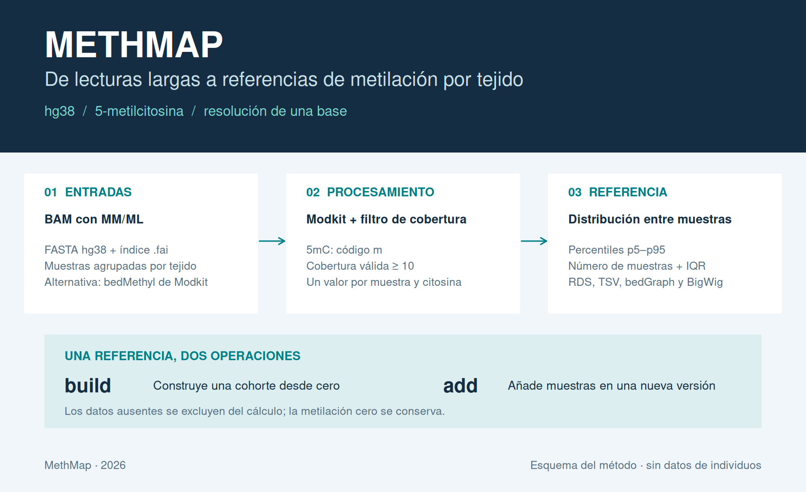
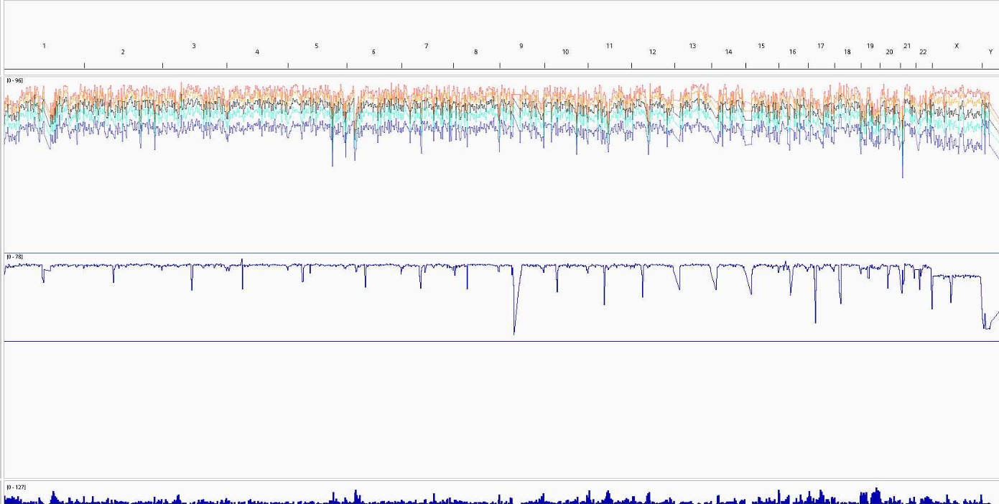
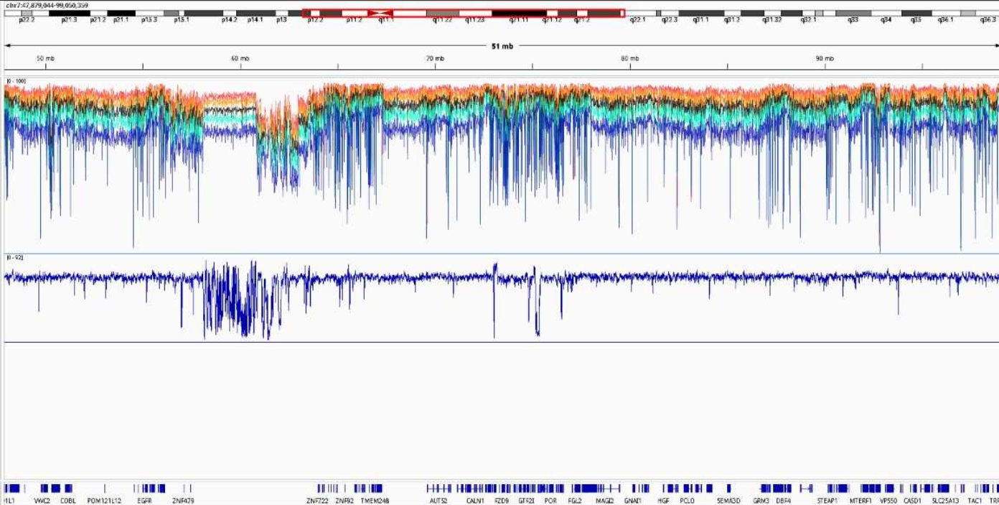

# MethMap

**Referencias de metilación específicas de tejido, a resolución de citosina, para el genoma humano hg38.**

MethMap (2026) es una herramienta bioinformática de desarrollo propio para construir mapas de referencia de **5-metilcitosina (5mC)** a partir de llamadas de metilación obtenidas mediante secuenciación de lectura larga. Integra muestras de un mismo tejido, conserva sus valores por posición y calcula estadísticas de la cohorte para describir la variabilidad epigenética y facilitar la comparación de patrones entre individuos.

La pipeline genera **19 percentiles —p5, p10, …, p95—**, mediana y amplitud intercuartílica. Además, cuantifica el **soporte poblacional de cada citosina**: el número y la proporción de muestras con cobertura suficiente que sustentan sus estimaciones en los distintos percentiles. Los resultados se exportan como RDS, TSV, bedGraph y BigWig.



## Qué hace

1. Lee un manifiesto de muestras y selecciona un tejido.
2. Ejecuta `modkit pileup` sobre BAM ordenados e indexados con etiquetas de modificación `MM/ML`, o importa bedMethyl ya generados por Modkit.
3. Retiene el código `m` —5mC— con **cobertura válida ≥10** por muestra y posición, configurable mediante `--min-coverage`.
4. Integra la unión de posiciones observadas por cromosoma, manteniendo la identidad de cada muestra.
5. Calcula los percentiles entre muestras y el soporte poblacional por citosina, y genera pistas para su visualización en navegadores genómicos.

El ámbito de este repositorio es la **construcción y ampliación de referencias de 5mC para hg38**. Parte de llamadas de modificación ya realizadas; el basecalling y el alineamiento se realizan previamente. La comparación se apoya en los valores individuales, los percentiles y las pistas exportadas: esta versión no ejecuta contrastes de metilación diferencial ni clasifica enfermedades.

## Ejemplo de visualización global



Vista global de las pistas de metilación en un navegador genómico. Los perfiles de los distintos percentiles permiten explorar la distribución poblacional a lo largo de los cromosomas. Las pistas de soporte generadas por MethMap permiten consultar cuántas muestras contribuyen a la estimación en cada citosina y qué proporción de la cohorte representan.

## Comparación de una región con los percentiles poblacionales

Puedes **añadir tu propio análisis en formato BigWig** al navegador genómico y comparar una región con los percentiles poblacionales de tus muestras o tejidos de interés. Al visualizar conjuntamente la pista individual y las pistas de referencia, puedes valorar posibles cambios epigenómicos, localizar desviaciones respecto a la distribución poblacional y explorar regiones con mayor variabilidad.



Ejemplo de exploración regional en el cromosoma 7. Carga tu BigWig junto con las pistas de percentiles del tejido seleccionado, utilizando el mismo ensamblaje y una escala de metilación comparable. Consulta también `hits` o `coverage_pct` para valorar el soporte poblacional de las posiciones observadas. La comparación visual orienta la exploración; los contrastes estadísticos se realizan en un análisis posterior.

Ambas capturas han sido aportadas por el autor y son ejemplos de visualización; no proceden de la demo sintética incluida en el repositorio.

## Instalación

Entorno de referencia: Linux, Python, R con `data.table`, Modkit, Samtools y la utilidad UCSC `bedGraphToBigWig`.

```bash
git clone https://github.com/Francisco100Iniesta/MethMap.git
cd MethMap
mamba env create -f environment.yml
conda activate methmap
python methmap.py doctor
```

También se puede usar `conda env create -f environment.yml`. El paquete de Bioconda se llama **`ont-modkit`** y proporciona el ejecutable `modkit`. El YAML fija Modkit 0.6.4 y restringe los intervalos de las demás dependencias; no es un archivo de bloqueo de todos los paquetes transitivos. Véase el [estado de validación](docs/VALIDATION.md).

La demo y el modo `--input-format bedmethyl --no-bigwig` solo requieren Python ≥3.10, R y `data.table`. `doctor` muestra lo que hay instalado; las dependencias necesarias se comprueban antes de cada ejecución.

## Prueba rápida sin datos reales

Los archivos pequeños de `examples/demo/` ya están incluidos. Se pueden regenerar con `python examples/generate_demo.py`.

```bash
python methmap.py build \
  --samples examples/demo/samples.tsv \
  --tissue DEMO \
  --reference examples/demo/synthetic.fa \
  --assembly synthetic \
  --input-format bedmethyl \
  --no-bigwig \
  --out results/demo
```

En la posición `chr1:1–2` de la demo, las seis muestras tienen valores `0, 20, 40, 60, 80, 100`. Los resultados esperados son `p5=5`, `p50=50`, `p95=95`, `hits=6` e `iqr=50`.

Para regenerar el esquema inicial del README y la figura auxiliar de la demo sintética:

```bash
Rscript scripts/make_figures.R results/demo docs/assets
```

Este comando no modifica las capturas de visualización global y regional aportadas por el autor.

## Preparar las entradas

### Referencia

Pasa la ruta de tu **FASTA hg38 sin comprimir**. Debe ser la misma referencia utilizada en el alineamiento y tener un índice `.fai` adyacente:

```bash
samtools faidx /ruta/referencias/hg38.fa
```

MethMap obtiene los tamaños del índice suministrado; no descarga ni incluye un genoma. Por defecto selecciona los cromosomas `chr1`–`chr22`, `chrX` y `chrY` presentes en ese índice y excluye `chrM`, contigs alternativos y no localizados. Puedes indicar un subconjunto con `--chromosomes chr1,chr2,chrX`.

Si los nombres de tus secuencias son `1,2,...,X,Y`, indícalos expresamente mediante `--chromosomes`. No se renombran contigs ni se convierten coordenadas entre ensamblajes. `--assembly hg38` es una etiqueta de procedencia; **no demuestra por sí misma que el FASTA sea hg38**. Se comprueban los nombres y longitudes del BAM, los límites de las posiciones y la identidad SHA-256 del FASTA al ampliar una referencia.

### Muestras

Usa un TSV —separado por tabuladores— con estas tres columnas exactas:

```tsv
sample_id	tissue	path
sample01	BLOOD	/data/blood/sample01.mod.bam
sample02	BLOOD	/data/blood/sample02.mod.bam
sample03	INTESTINE	/data/intestine/sample03.mod.bam
```

Hay plantillas en [config/](config/samples.example.tsv). Las rutas pueden ser absolutas o relativas **a la carpeta del TSV**. Cada ejecución selecciona un solo tejido. Los identificadores y las rutas deben ser únicos dentro de esa cohorte; usa una entrada por individuo si quieres interpretar las estadísticas como variación entre individuos. MethMap no puede inferir si dos muestras pertenecen a la misma persona.

Los BAM deben estar ordenados por coordenadas, indexados y contener llamadas de modificación compatibles con Modkit. No basta con un BAM alineado sin `MM/ML`. Consulta la [documentación de Modkit](https://nanoporetech.github.io/modkit/advanced_usage.html) para los requisitos de entrada y filtrado.

## Construir una referencia hg38

```bash
python methmap.py build \
  --samples config/samples.tsv \
  --tissue BLOOD \
  --reference /ruta/referencias/hg38.fa \
  --out results/BLOOD_v1 \
  --min-coverage 10 \
  --min-samples 2 \
  --threads 12 \
  --jobs 2
```

También funciona `bash full.sh` con los mismos argumentos. `build` acepta una o más muestras; no exige las etiquetas especiales `sample01` y `sample02` de la pipeline original. Con una sola muestra los percentiles coinciden y no describen variación poblacional.

Añade `--dry-run` para revisar la selección de muestras, rutas, cromosomas y parámetros sin ejecutar herramientas. Esa revisión no inspecciona todavía las llamadas del BAM ni valida el contenido completo de los datos.

### Partir de bedMethyl existentes

```bash
python methmap.py build \
  --samples config/bedmethyl_samples.tsv \
  --tissue BLOOD \
  --reference /ruta/referencias/hg38.fa \
  --input-format bedmethyl \
  --out results/BLOOD_from_bedmethyl
```

El TSV conserva las mismas columnas; `path` apunta ahora a un bedMethyl de Modkit de 18 columnas, sin combinar hebras, con un registro 5mC por posición y muestra. Se admite texto o `.gz`. La columna 11 debe contener porcentajes **0–100**. Se comprueba su coherencia con los conteos y se rechazan posiciones duplicadas. Los archivos intermedios de cinco columnas de la pipeline antigua no son bedMethyl completos y no son una entrada válida de este modo.

En este modo, los filtros de confianza del basecaller/Modkit ya se aplicaron fuera de MethMap; usa la misma política de procesamiento para toda la cohorte. No mezcles resultados por haplotipo con resultados de la muestra completa.

## Añadir nuevas muestras

```bash
python methmap.py add \
  --base results/BLOOD_v1 \
  --samples config/samples_to_add.tsv \
  --tissue BLOOD \
  --reference /ruta/referencias/hg38.fa \
  --out results/BLOOD_v2 \
  --min-coverage 10 \
  --min-samples 2 \
  --threads 12 \
  --jobs 2
```

`add` —o `bash adding.sh`— crea una **nueva versión** y conserva la anterior. Comprueba el tejido, la referencia, los cromosomas, el umbral de cobertura y la configuración de Modkit; impide reutilizar identificadores o rutas de muestras ya incorporadas. `--min-samples` puede cambiar entre versiones porque solo filtra la exportación de pistas.

Las referencias RDS antiguas no guardan los identificadores individuales de forma recuperable. Para este paquete se reconstruyen desde los BAM originales o sus bedMethyl completos; no se importan automáticamente como referencias ampliables.

## Resultados

```text
results/BLOOD_v1/
├── run.json                 # Parámetros, muestras, versiones y SHA-256 de referencia
├── chrom.sizes              # Dos columnas derivadas de tu .fai
├── reference/chr*.rds        # Valores por citosina, identificados por muestra
├── statistics/chr*.tsv.gz    # Estadísticas de todas las posiciones observadas
├── tracks/
│   ├── p5.bedGraph … p95.bedGraph
│   ├── p5.bw … p95.bw
│   ├── hits.bedGraph / hits.bw
│   ├── coverage_pct.bedGraph / coverage_pct.bw
│   ├── score.bedGraph / score.bw
│   └── iqr.bedGraph / iqr.bw
├── qc/                      # Resúmenes por muestra y cromosoma
└── logs/                    # Registro de cada etapa
```

| Campo o pista | Significado |
| --- | --- |
| `p5`…`p95` | Percentiles entre los porcentajes observados, en pasos del 5%; `p50` es la mediana. |
| `hits` | Número de muestras con cobertura suficiente en la posición. |
| `coverage_pct` | `100 × hits / número total de muestras de la cohorte`. |
| `score` | Métrica original: `100 × hits / máximo de hits observado en ese cromosoma`. |
| `iqr` | `p75 − p25`, amplitud intercuartílica en puntos porcentuales. |

`score` mide representación relativa dentro de un cromosoma; no es cobertura de lecturas ni un valor de significación. `coverage_pct` permite interpretar directamente la proporción de la cohorte representada, incluyendo muestras sin observaciones en ese cromosoma.

Las coordenadas son **BED: base 0, extremo final excluido**. Las pistas se ordenan y contienen posiciones con `hits >= --min-samples`; los TSV estadísticos conservan todas las posiciones observadas. No se añaden ceros a regiones sin datos. Si ninguna posición supera el umbral, los bedGraph quedan vacíos y no se genera un BigWig para ellos; queda registrado en `run.json`.

Las pistas BigWig permiten explorar resultados en IGV o UCSC. La conversión utiliza un archivo de tamaños de dos columnas, como requiere el [formato BigWig de UCSC](https://genome.ucsc.edu/goldenPath/help/bigWig.html).

Para acceder a los valores individuales en R:

```r
ref <- readRDS("results/BLOOD_v1/reference/chr1.rds")
ref$sample_ids
head(ref$sites[, c("chr", "start", "end")])
ref$sites$values[[1]]  # Vector numérico nombrado por sample_id
```

## Método e interpretación

Se calcula un porcentaje por muestra y citosina y, después, su distribución entre muestras: **no se agrupan las lecturas de todos los individuos**. Cada valor observado tiene el mismo peso una vez superado el filtro de cobertura. Los cuantiles usan `quantile(..., type = 7)` de R, igual que el método por defecto de la implementación original.

Los datos ausentes se excluyen; los valores cero válidos se mantienen. El rango p5–p95 es un intervalo descriptivo de la cohorte, no un intervalo de confianza ni un umbral diagnóstico. La composición del tejido, el tamaño de la cohorte, las réplicas y las diferencias técnicas afectan a su interpretación. Las posiciones con pocas muestras pueden tener percentiles poco representativos.

El comportamiento original se conserva: **no se restringe explícitamente a CpG y no se combinan las dos hebras**. El contexto disponible depende de las llamadas del modelo utilizado. Modkit procesa 5mC y 5hmC, pero MethMap solo exporta 5mC; no suma ambas modificaciones. La cobertura válida es la definida por [Modkit para bedMethyl](https://github.com/nanoporetech/modkit#description-of-bedmethyl-output).

## Recursos y ejecución en SLURM

`--threads` controla los hilos de Modkit; `--jobs` controla cuántos cromosomas se integran simultáneamente. Las muestras se procesan una a una. Cada proceso de R trabaja con un cromosoma, pero las listas de valores crecen con el número de posiciones y muestras: la memoria puede ser considerable en genoma completo. Empieza con `--jobs 1` y dimensiona la memoria a partir de una ejecución representativa; la demo no mide el rendimiento en hg38.

```bash
conda activate methmap
mkdir -p logs
sbatch --job-name=MethMap --cpus-per-task=12 --mem=64G \
  --output=logs/methmap-%j.log \
  scripts/submit_slurm.sh build \
  --samples /ruta/proyecto/config/samples.tsv \
  --tissue BLOOD --reference /ruta/referencias/hg38.fa \
  --out /ruta/resultados/BLOOD_v1 --threads 12 --jobs 1
```

Envía el trabajo desde la raíz del repositorio, o define `METHMAP_HOME` con esa ruta antes de usar `sbatch`. Los 64 GB son un ejemplo de solicitud, no una estimación validada. Añade la partición y los límites propios de tu clúster. No hay nombres de colas, cuentas o directorios del servidor original en los lanzadores.

La carpeta final solo aparece al terminar correctamente. Si falla una etapa, queda una carpeta `*.partial-*` con los registros para diagnosticarla. Las salidas existentes se protegen; usa una ruta nueva al reejecutar. `--keep-intermediates` conserva los RDS por muestra y los bedGraph por cromosoma.

## Validación y procedencia

```bash
python -m unittest discover -s tests -v
```

Las pruebas cubren resultados numéricos conocidos, cero frente a ausencia, cromosomas vacíos, incorporación de nuevas posiciones, filtrado de cobertura, duplicados, conservación de la referencia previa y cambios de FASTA. Incluyen una prueba BAM→Modkit→BigWig que se ejecuta cuando están instaladas todas las herramientas.

Consulta el [análisis de la pipeline original y los cambios](docs/PIPELINE_REVIEW.md), el [estado de validación](docs/VALIDATION.md) y las [instrucciones para publicar](docs/PUBLISHING.md). Los datos de la demo son sintéticos. Las capturas global y regional son ejemplos aportados por el autor; no se distribuyen los archivos de muestras de la cohorte original.

## Autoría y descripción breve

**Francisco Iniesta · MethMap · 2026**

> **MethMap (2026).** Desarrollo propio de una herramienta bioinformática para construir mapas de referencia de metilación del genoma humano hg38 específicos de tejido, con resolución a nivel de citosina, a partir de llamadas de metilación de secuenciación de lectura larga. Integra muestras individuales, caracteriza la variabilidad epigenética mediante percentiles y amplitud intercuartílica, cuantifica el soporte poblacional de cada citosina y genera pistas BigWig para comparar regiones con los perfiles poblacionales de los tejidos de interés y explorar posibles cambios epigenómicos.

Repositorio: [Francisco100Iniesta/MethMap](https://github.com/Francisco100Iniesta/MethMap). Metadatos de citación en [CITATION.cff](CITATION.cff).
